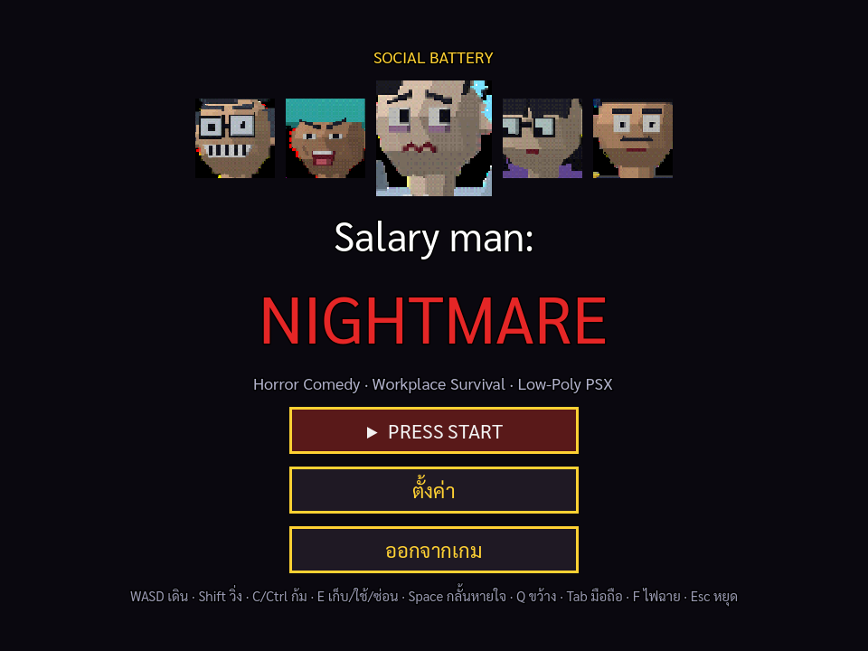
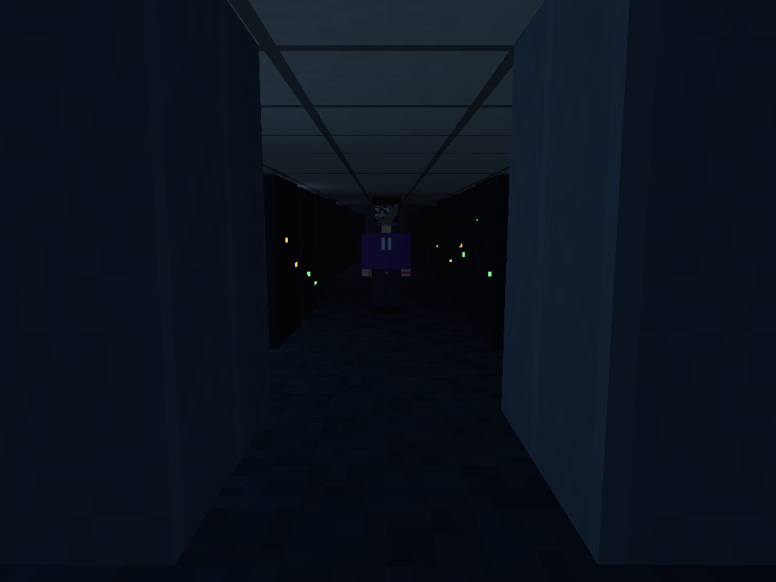
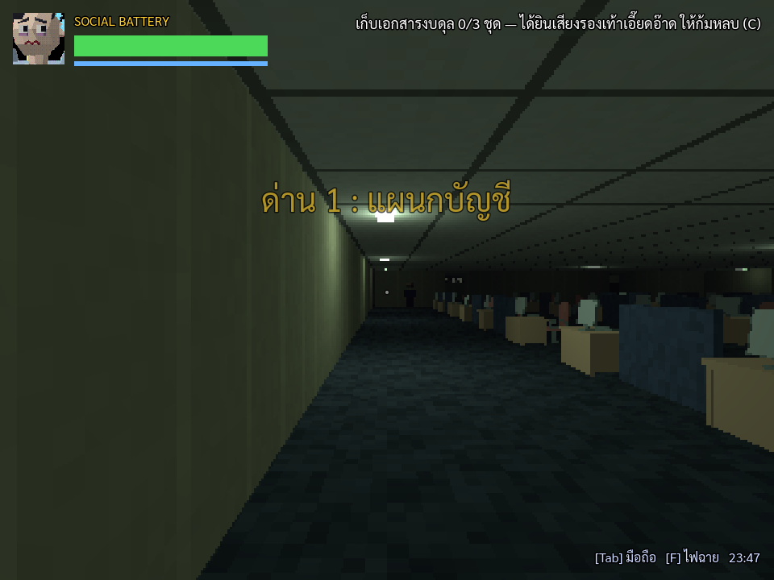
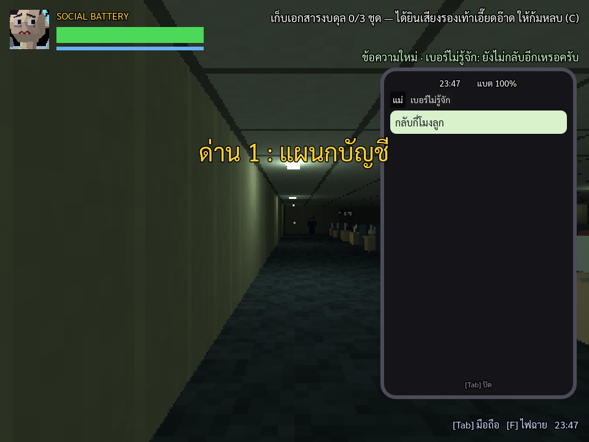
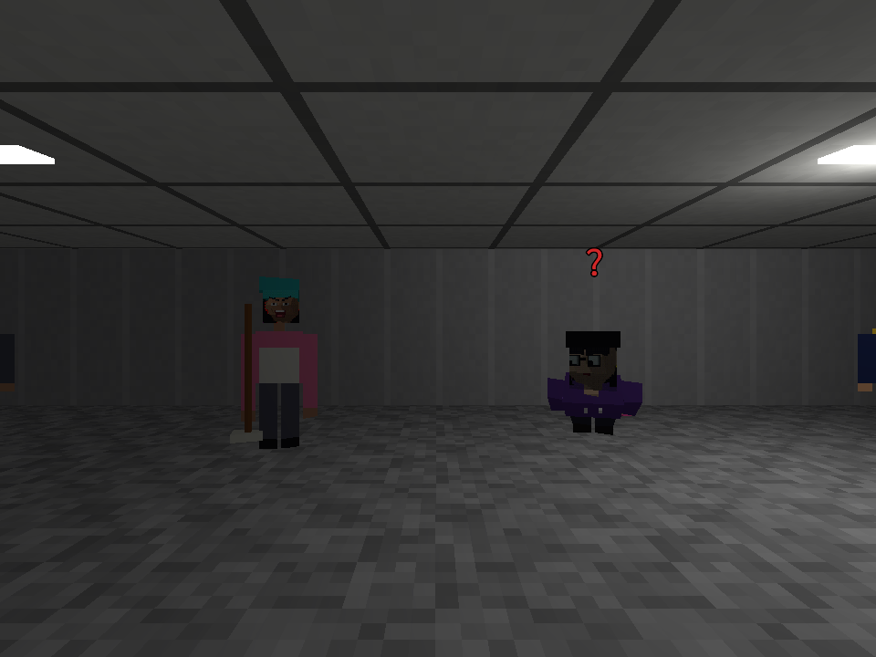
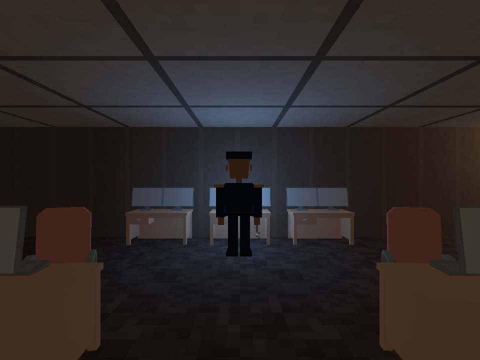
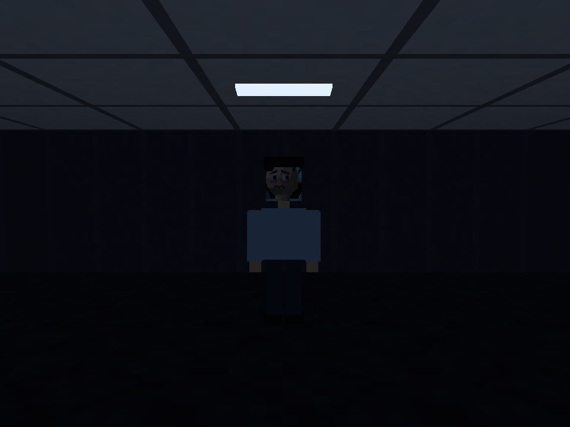

**รายงานการออกแบบเกม 3D** 

วิชา \[  \] CP352203  Computer Game Development 

วิชา \[ X \] CP410844  Computer Game Development 

**ภาคการศึกษาต้น ปีการศึกษา 2569**

## **ชื่อเกม :**  Salary man: Nightmare 

[**https://canva.link/eg7n3rjg7y74c8c**](https://canva.link/eg7n3rjg7y74c8c)

## **กลุ่มที่**  2  

**จัดทำโดย :** 

1. 673380307-8 กีรติ ชาวงษ์ CP-AI   
2. 673380320-6 ธราเทพ เบญจพรหม CP-AI  
3. 673380327-2 พรนัชชา ทราบรัมย์ CP-AI  
4. 673380361-2 แดนชล ประไชโย CP-AI

## **ธีม หรือ แนวเกม (Game Genres):** 

Horror Comedy / Social Anxiety & Workplace Survival / Low-Poly PSX Retro 

## **ตัวอย่างเกมที่คล้ายกัน:** 

*Sins of Sinister: The Viscera-Eater*, *Scary Game 2*, *Night Shift* 

## **เนื้อเรื่องย่อ :**  

"ต๋อง" พนักงานบัญชีผู้อยากทำงานเงียบๆ คนเดียวในคืนวันศุกร์เพื่อรีบกลับบ้าน แต่กลับต้องเผชิญหน้ากับฝันร้ายที่แท้จริง นั่นคือ **"เพื่อนร่วมงานกะดึกสุดเพี้ยน"** ที่ไม่ยอมกลับบ้านเสียที แต่ละคนมีพฤติกรรมหลอนประสาทระดับ Uncanny Valley ทั้งเดินสับขาผิดธรรมชาติ โผล่มาจ๊ะเอ๋แบบไร้สุ้มเสียง และพยายามยัดเยียดบทสนทนาไร้สาระ ต๋องต้องหาทางเคลียร์เอกสาร 3 แผนก หลบหลีกการปะทะ และเอาตัวรอดจากการถูกสูบพลังชีวิตทางสังคม (Social Battery) ออกไปสแกนนิ้วเลิกงานให้ทันเวลา 

## **ตัวละคร:**

* **ต๋อง (ผู้เล่น):** พนักงานผู้มีอาการ Social Anxiety สภาพจิตใจพร้อมแตกสลาย มีค่าพลังชีวิตเป็น **"Social Battery"** (แทนหลอดเลือด/สติ) ถ่านหมดเมื่อไหร่คือล้มพับ  
* **หัวหน้าธนา (The Micromanager):** ชายวัยกลางคนใส่แว่นหนาเตอะ ยิ้มกว้างค้างตลอดเวลา เดินสับขาเร็วเป็นวงกลม คอยย่องมาโผล่หน้าข้ามฉากกั้นโต๊ะแบบคอยืดยาว พร้อมยื่นหน้ามาถามเสียงยานคาง *"งานคืบหน้ากี่เปอร์เซ็นต์แล้วจ๊ะ?"* ถ้าโดนจับได้จะโดนลากไปนั่งฟังเลกเชอร์ชีวิต 3 ชั่วโมง  
* **ป้าพร แม่บ้านสายมู (The Floor Sweeper):** OCD / ป้าแม่บ้านที่ถูพื้นซ้ำไปซ้ำมาตรงจุดเดิม แขนขายาวเก้งก้าง เคลื่อนที่แบบสไลด์ไปกับพื้นโดยไม่ก้าวขา คอยเอาน้ำมนต์ไล่พรมใส่คน และตะโกนสาปแช่งใครก็ตามที่เดินเหยียบพื้นเปียก  
* **เต้ ไอทีซัพพอร์ตสุดเนิร์ด (The IT Goblin):** aka โอตาคุ หนุ่มไอทีที่ไม่ยอมสบตาใคร เดินค่อมตัวกึ่งคลานมุดอยู่ใต้โต๊ะทำงานเพื่อจัดสายไฟ ชอบโผล่พรวดขึ้นมาจากใต้โต๊ะที่ผู้เล่นกำลังจะมุดซ่อน พร้อมพูดจาด้วยศัพท์เทคนิคภาษาเอเลี่ยนรัวๆ จนหูดับ  
* **พี่สมชาย (รปภ. กะดึก):** aka จ่าเฉย (Stalker) ไม่ได้อยู่ที่ป้อมหน้าลิฟต์ แต่ยืนเฝ้าจอกล้องวงจรปิดอยู่ในห้อง รปภ. ซึ่งเป็นห้องพักของเขาเอง (มีเตียง ตู้ และจอกล้องที่ทุกจอชี้มาที่โต๊ะต๋อง) ตัวแข็งทื่อเหมือนหุ่น ขยับเฉพาะตอนไม่มีใครมอง นานๆ ทีจะโทรเข้าโต๊ะผู้เล่นเพื่อเล่าเรื่องมุกแป้ก หรือถามว่าซื้อข้าวมันไก่มาฝากไหม

## **รูปแบบการเล่น และ กติกา:**

**ด่าน 0 บทนำ/ฝึกสอน (เล่นก่อนด่าน 1 แบบกึ่งคัตซีน, ข้ามได้จากเมนูหยุด):** เย็นวันศุกร์ 17:30 ออฟฟิศสว่างสดใส หัวหน้าธนา ป้าพร เต้ และพี่สมชายยังทำงานตามปกติและคุยกับต๋องได้ (กด E) เบอร์ไม่รู้จักทักเข้ามือถือ — ขยับไม่ได้เลยจนกว่าจะกด Tab เปิดอ่าน ข้อความนั้นคือวิธีควบคุมทั้งหมด พอทักทายครบ เวลาเดินไปถึง 23:30 แสงค่อยๆ หาย ทุกคนทยอยกลับ (หันไปมองอีกทีไฟกะพริบแล้วไม่อยู่) เบอร์เดิมทักมาเล่าเรื่องเล่าของบริษัทว่า ใครทำงานกะดึกบ่อยๆ จะเจออะไรแปลกๆ เพราะความเครียดสะสม แล้วชวนไปส่องกระจก จบด้วยคัตซีนต๋องส่องกระจกค้างไว้ 3 วินาที ก่อนป้าพร หัวหน้าคอยืด เต้ และพี่สมชายค่อยๆ เฟดเข้ามายืนข้างหลังพร้อมดนตรีสยองขวัญ แล้วตัดดำเข้าด่าน 1

**Core Loop แบบแบ่งด่าน (4 Stages) — แต่ละด่านมีกลไกหลักไม่ซ้ำกัน:**

* ด่านที่ 1: แผนกบัญชี (หลบหัวหน้าธนา) — **ลอบเร้นคลาสสิก** ย่องเก็บเอกสารงบดุล 3 ชุด ต้องคอยฟังเสียงรองเท้าคัตชูเอี๊ยดอ๊าด ถ้าได้ยินต้องรีบก้มหลบหลังโต๊ะ โน้ตในด่านบอกตำแหน่งเอกสารและทางเดินของหัวหน้า  
* ด่านที่ 2: โถงทางเดินและโซนพักผ่อน (เอาชีวิตรอดจากป้าพร) — ภารกิจเดินไปชงกาแฟเติม Social Battery โดยห้ามเหยียบรอยน้ำถูพื้นของป้าพรเด็ดขาด ไม่งั้นป้าจะวิ่งกวดเอาไม้ม็อบไล่ตี **พื้นมีแอ่งน้ำกระจายอยู่ทั่วชั้นตั้งแต่เริ่มด่าน (ไม่แห้ง และสุ่มตำแหน่งใหม่ทุกครั้งที่เล่น)** แล้วป้ายังถูเพิ่มรอยใหม่ตามทางที่เดินอีก ต้องเดินอ้อมเอง — **ชงเสร็จปุ๊บ ป้ารู้ว่าเป็นถ้วยกาแฟของป้า = ฉากไล่ล่า (Chase sequence) วิ่งหนีไปลิฟต์** (มี checkpoint ที่เครื่องชงกาแฟ)  
* ด่านที่ 3: ห้องเซิร์ฟเวอร์ (ดวลกวนประสาทกับเต้ ไอที) — กู้รหัสผ่านเครื่องปรินต์ เดินตามหารหัสผ่านเพื่อเข้าเครื่องคอมเอางบดุลลับ ต้องมุดใต้โต๊ะแข่งกับเต้ ระวังอย่าให้เต้คลานมาปาดหน้าดักทาง — **ไฟดับทั้งชั้น** เหลือแต่ไฟฉุกเฉินสีแดง ต้องสับเบรกเกอร์ (เสียงดัง เต้ได้ยิน) แล้วเอาตัวเลขจากโพสต์อิท 3 ใบมาประกอบเป็นรหัส พิมพ์ที่คอมห้อง Admin (ใส่ผิด = สัญญาณเตือนดังลั่น) **หลบเต้ได้ด้วยการซ่อนในล็อกเกอร์หรือใต้โต๊ะแล้วกลั้นหายใจ (Space) ตอนเขามาค้น:** เขาค้นครั้งเดียว ไม่เจอก็กลับไปมุดโต๊ะตัวอื่น แต่ใต้โต๊ะคือถิ่นของเต้ มุดเมื่อไหร่เขาจะมาดูเสมอ ส่วนล็อกเกอร์ปลอดภัยถ้าเขาไม่เห็นตอนเข้า  
* ด่านที่ 4: ออกจากบริษัท (ผ่านรปภ.ไปให้ได้) — ป้อมกลางล็อบบี้ว่างเปล่า พี่สมชายยืนหันหลังดูจอกล้องอยู่ในห้อง รปภ. (ห้อง CCTV + ห้องพักของเขา) และเห็นต๋องจากกล้องตลอด **เขาอยู่ตรงนั้นจนกว่าไฟจะดับครั้งแรก หรือมือถือของเขาที่วางข้างเตียงถูกขโมย** (มือถือนี้คือหลักฐานสำหรับ Ending A) จากนั้นเขาออกมาตาม: ระหว่างเดินต้องเห็นรปภ.ไว้ในสายตา **ไฟตึกดับเป็นพักๆ ตอนมืดเขาขยับได้ (ต้องเปิดไฟฉายส่อง)** ฉากจบ: ต้องกดค้างสแกนนิ้ว 3 วินาที (ต้องละสายตาจากเขา) พร้อมกับที่ทุกคนลงลิฟต์มาไล่  
  **กติกาแพ้-ชนะ:**  
* ชนะแบบกลับบ้านสบายใจ (a ending): ออกจากบริษัทให้ได้ ขโมยโทรศัพท์เพื่อนำไปแจ้งตำรวจ กลับบ้านแบบสบายใจ  
* ชนะแบบทุกอย่างที่เกิดขึ้นคือในฝัน (b ending): ตื่นมาที่โรงพยาบาล หันซ้ายหมอ หันขวา… เงื่อนไขตามกฎ 3 ข้อ   
* แพ้แบบรปภ. ตามติดชีวิตกลับบ้านไปด้วย (c ending): ไม่ได้สนใจคำพูดตัวละครที่รู้สึกโดนจ้องมอง หรือแปลกๆกับรปภ.  
* ตาย (Social Battery \= 0): โดนหัวหน้าลากไปคุย, โดนป้าพรบ่นใส่หู, หรือโดนเต้ชวนคุยเรื่องการ์ตูน จนผู้เล่นหมดพลังชีวิต ล้มลงไปนอนตาลอยกับพื้นออฟฟิศ ยอมแพ้ต่อโชคชะตา

## **แนวคิดการออกแบบ**

* **Uncanny Human Comedy:** ความน่ากลัวไม่ได้มาจากความดุร้าย แต่มาจาก **"ความแปลกของพฤติกรรมมนุษย์"** เช่น รอยยิ้มค้าง ตาไม่กะพริบ ท่ายืนแอ่นตัวผิดรูป แอนิเมชันขยับกระตุกๆ สไตล์เกมค่าย Puppet Combo หรือ *Viscera-Eater*  
* **Soundtrack & Foley สุดฮา:** เสียงก้าวเท้าแปลกๆ (เสียงรองเท้าหนังเอี๊ยดอ๊าดเหมือนเป็ด), เสียงฮัมเพลงผิดคีย์ของป้าพร, เสียงพึมพำบ่นเรื่องประชุมของหัวหน้า

## **กลุ่มเป้าหมาย**

ผู้เล่นที่ชอบเกมแนว Awkward Comedy ผสมบรรยากาศระทึกขวัญ

คนทำงานออฟฟิศ นักศึกษา หรือชาว Introvert ที่อินกับความทรมานจากการถูกเพื่อนร่วมงานประหลาดตามตื๊อ

สตรีมเมอร์สายตลกที่ต้องการโมเมนต์หลุดขำกับท่าทางการเดินและบทสนทนากวนๆ ของ NPC

## **การพัฒนาเกม Godot**

**Template/Starter Kit ที่ใช้ :** ไม่ได้ใช้ Starter Kit — เขียน GDScript เองทั้งหมดบน Godot 4.7 (ด่านสร้างจากแผนที่ ASCII แล้วแก้ต่อใน editor, AI เดินด้วย NavigationAgent3D, ตัวละครโมเดลจาก Blender, ภาพสไตล์ PSX ด้วย SubViewport ความละเอียด 320x240 + vertex-snap shader)

**ASSET ที่ใช้:** (รายละเอียดใน `ASSETS.md`)
* โมเดลตัวละคร — สร้างเองใน Blender 5.2 ด้วยสคริปต์ `tools/blender/build_characters.py` (ผลงานกลุ่ม)
* Kenney Furniture Kit — โต๊ะ เก้าอี้ จอคอม เครื่องชงกาแฟ ต้นไม้ ฯลฯ (CC0)
* Kenney RPG Audio — เสียงฝีเท้า ประตู กระดาษ (CC0)
* ฟอนต์ Sarabun (SIL OFL)
* เสียงสยองขวัญจาก freesound.org (CC0 ทั้งหมด 10 ไฟล์: เสียงหัวใจเต้น, ดนตรีตอนโดนไล่, เสียงลิฟต์, เสียงเคาะประตู, เสียงกระซิบ ฯลฯ)
* หน้าตัวละครบนเมนู/HUD/jumpscare/ฉากจบ เป็นโมเดล 3D ตัวเดียวกับในเกม (เรนเดอร์สดใน `scripts/face_view.gd`), เสียง jumpscare ผสมจากเสียง CC0 ด้วย `tools/synth_jumpscare.py`, เสียงเพิ่มเติม (โทรศัพท์ รองเท้าเอี๊ยด ป้าพรฮัมเพลง เครื่องวัดชีพจร) สังเคราะห์ด้วย `tools/synth_sfx.py`

**ระบบในเกม:** ด่าน 0 บทนำ + แผนที่ 4 ด่าน (หลายห้อง), คัตซีน 3D, ที่ซ่อน (ล็อกเกอร์ / ห้องน้ำ / ใต้โต๊ะ) + กลั้นหายใจ, ขว้างของล่อ, มือถือต๋อง (แชตเล่าเรื่อง + ไฟฉาย), เบาะแสความฝัน 4 ชิ้น → Ending B, พี่สมชายโผล่ยืนไกลๆ + รูปแอบถ่าย, เซฟ/เล่นต่อ

**ระบบเพิ่มเติม (v3):**
* **ตัวละครโมเดลจริงจาก Blender** ทุกตัว (ต๋อง หัวหน้าธนา ป้าพร เต้ พี่สมชาย หมอ หุ่นซ้อม) ตามภาพในสไลด์ Pitch — หน้าตาปั้นเป็นโมเดล (แว่นหนา ฟันยิ้มค้าง ผ้าโพกหัว หนวดเครา) ไม่ใช่รูปแปะ แบบ segmented ชิ้นส่วนแข็งหมุนที่ข้อต่อแบบเกม PS1 ไฟล์ .blend เปิดแก้ต่อได้
* **โน้ตมีประโยชน์จริง:** อ่านแล้วได้คำใบ้ (ลูกศรชี้ของที่ต้องเก็บมองทะลุกำแพง / บอกที่ซ่อน / เห็นตำแหน่งศัตรู) และโน้ตเรื่องพี่สมชายนับเป็น "หลักฐาน" → Ending A ต้องมีมือถือพี่สมชาย + หลักฐาน ≥ 4
* **ความน่ากลัวเพิ่ม:** จุดหลอนแบบสคริปต์ (ไฟดับ, มีคนยืนจ้องปลายทางเดิน, โผล่ข้างหลังพุ่งใส่เมื่อหันไป, เสียงเคาะจากห้องน้ำ), ภาพหลอนตาม Social Battery (จอสั่น/สีเพี้ยนแบบเทป VHS + เห็นเพื่อนร่วมงานที่ไม่มีอยู่จริง), ช่วงมืด + ไฟฉาย (ในความมืดศัตรูมองเห็นใกล้ลง แต่เห็นแสงไฟฉายจากไกล), ฉากไล่ล่า
* **แก้ไขได้ใน Godot Editor โดยไม่ต้องเขียนโค้ด:** ข้อความโน้ต จุดเล่าเรื่อง จุดหลอน ขั้นตอนบทฝึก และกลไกของด่าน ตั้งค่าใน Inspector ได้ทั้งหมด — คู่มือภาษาไทยทีละขั้นที่ `EDITING.md`

**ตัวอย่าง  Scene:**

	

	**Github :** https://github.com/Phonnatcha-kku/Game_Dev_Final

